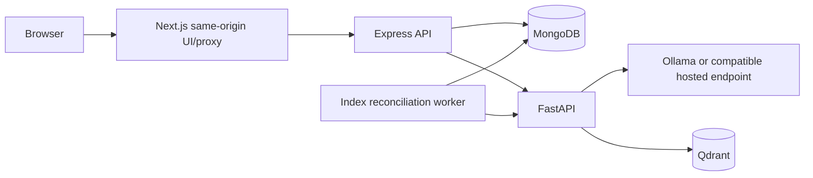

# Architecture and engineering trade-offs

## Operational data
Existing User, Question, Company and Topic collection names and IDs remain. New user fields are preferences/bookmarks; city becomes optional. Question additions include publication state, rubric, concepts, roles, attribution, and index revisions. Legacy external-platform fields remain optional.

Sessions store a random JWT identifier, owner, expiry and CSRF token. MongoDB TTL cleans expired sessions, but every request also checks expiry immediately. JWTs use HS256, a configured secret, and server-side revocation. Password hashes remain bcrypt-compatible.

Interviews embed at most ten bounded turns so atomic single-document updates protect answer acceptance. The owner and version are checked in the update predicate. A caller-supplied UUID deduplicates retries. Generation uses a durable operation lease and unique operation ID; stale completions cannot overwrite cancelled work. Reports preserve model and prompt version. A crash between accepting an answer and inference leaves a resumable operation.

## AI boundary
Express sends bounded session context to FastAPI using a private service token. FastAPI validates both input and model output. Ollama is the default; the compatible adapter accepts a configured base URL/model/key. No provider credentials go to the browser. A small model can follow the schema while producing weak content; schema correctness is not semantic accuracy.

The evaluation rubric anchors dimensions at 0,25,50,75,100. Overall score is computed as 50% technical correctness, 30% reasoning, 20% communication. Recommendations prioritize topic averages below 75. These are practice heuristics, not validated measures of hiring ability.

Provider calls have timeouts, at most two attempts, and one concurrent generation per AI-service process. User answers are untrusted evidence. Prompt instructions and output validation reduce risks but cannot guarantee immunity to prompt injection.

## Search consistency
MongoDB is authoritative. Question changes increment indexRevision; a periodic worker reconciles records where indexedRevision differs. Deletes archive first, then remove the point. MongoDB hydration rechecks publication, so stale vectors cannot expose archived content. Revision checks keep concurrent edits pending. A database lease serializes index workers.

Qdrant collection names append a hash of embedding model and dimension. Changing either creates a separate collection; run a full rebuild before switching traffic. Stable question IDs map to deterministic UUID point IDs. Keyword fallback is explicit. Basic semantic ranking precedes advanced hybrid retrieval.

## Deliberate limits
No arbitrary code execution, voice, Redis, billing, email delivery or hidden production mocks. API modules remain JavaScript; the web is strict TypeScript. JSON generation is currently nonstreaming. History/admin lists are bounded; large-scale cursor pagination and multi-instance distributed rate limiting remain future scaling work. Hosted inference and container deployment need independent environment validation.
